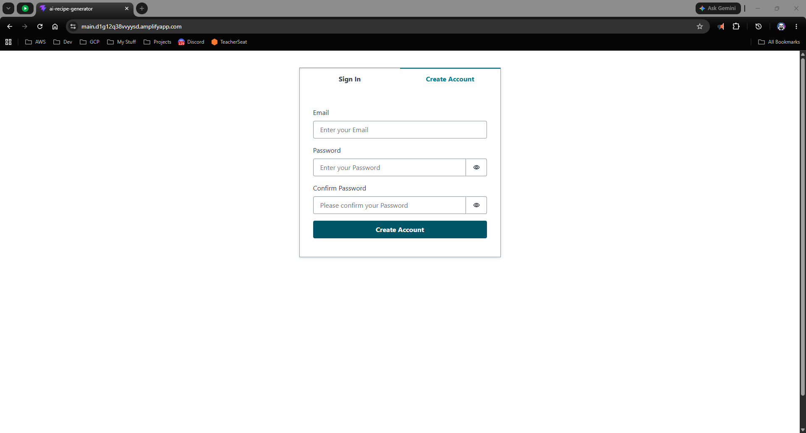
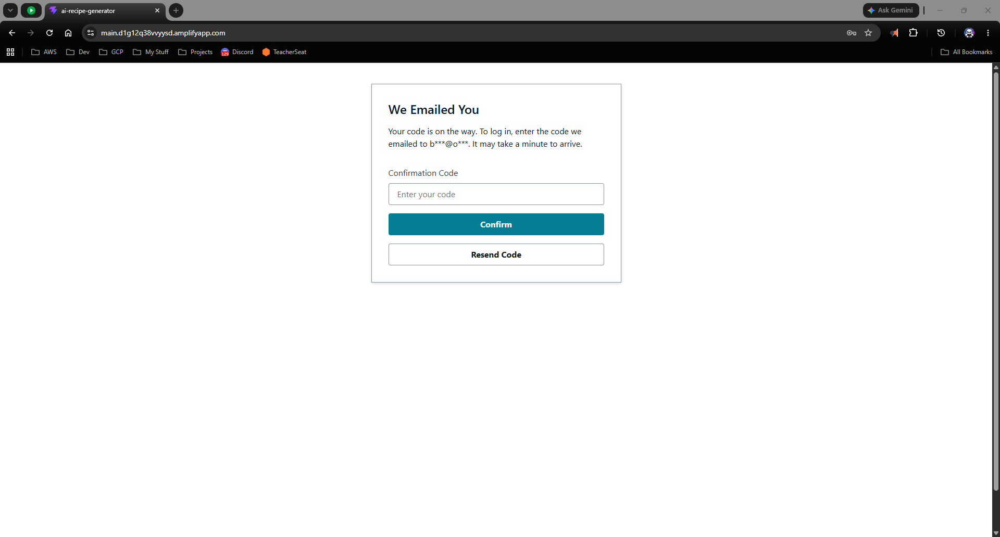
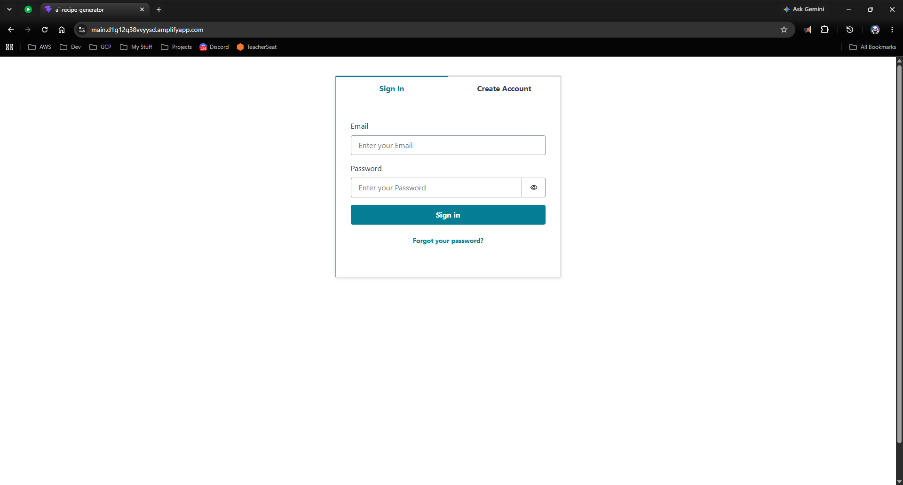
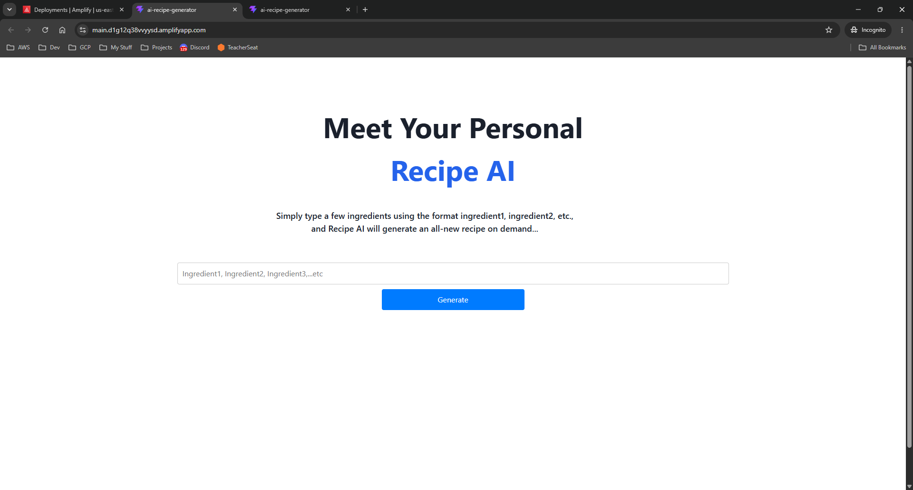
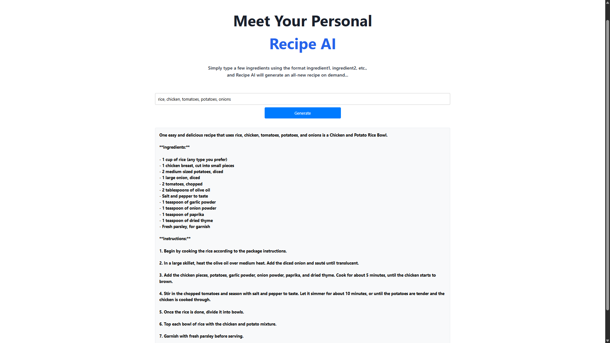
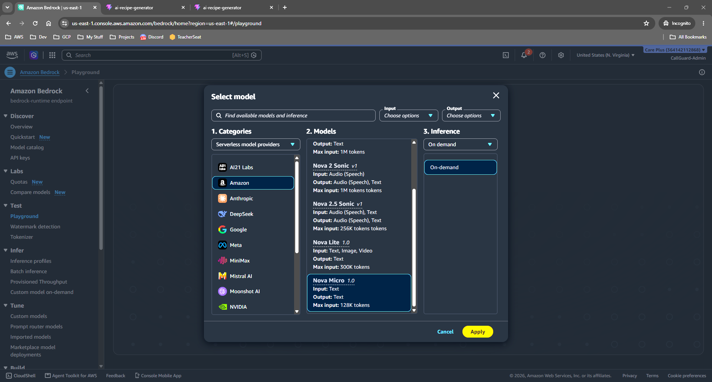
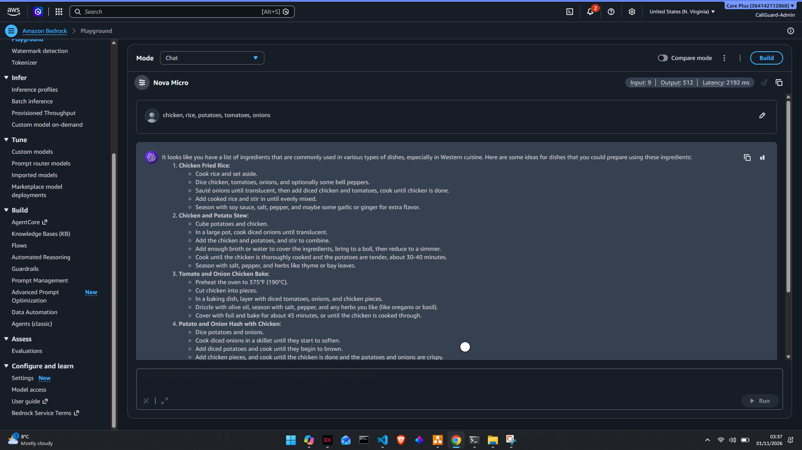
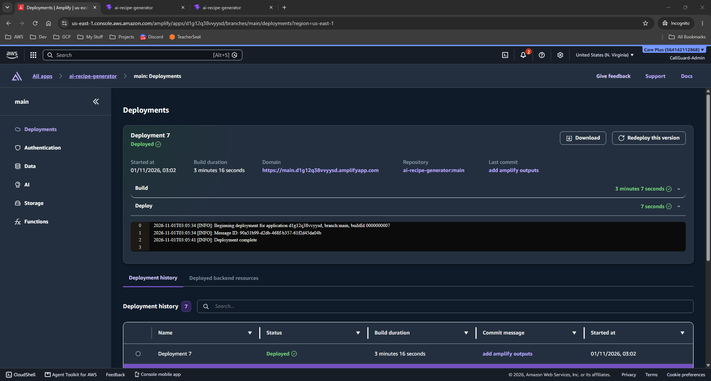
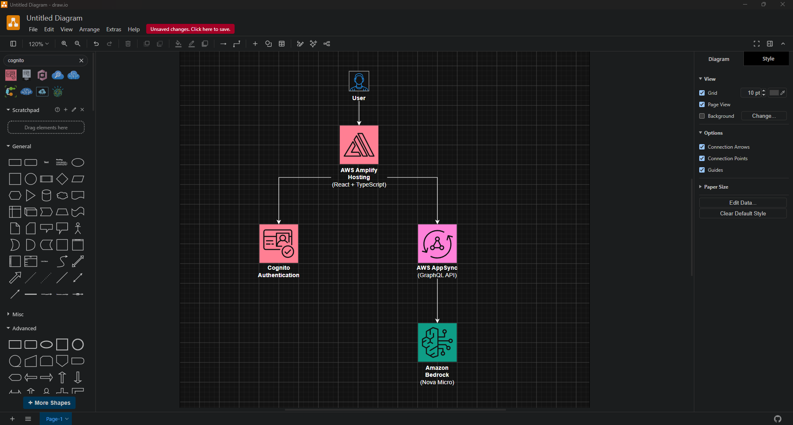

# AI Recipe Generator

An AI-powered recipe generation application built with React, TypeScript, and AWS services. Users can enter ingredients they have available and generate recipe ideas using Amazon Bedrock and Amazon Nova Micro.

---

## ☁️ AWS Deployment Notes

**Region:** us-east-1 (N. Virginia)

**AWS Services Used:**

* AWS Amplify Hosting
* AWS Amplify Gen 2
* Amazon Cognito
* AWS AppSync
* Amazon Bedrock
* Amazon Nova Micro

---

## 📸 Screenshots

### 1. Create Account


### 2. Authentication


### 3. Sign In


### 4. Recipe Generator


### 5. Generated Recipe


### 6. Amazon Bedrock (Nova Micro)


### 6. Amazon Bedrock Playground


### 7. AWS Amplify Hosting


### 8. Architecture Diagram


---

## 🔧 Installation

### 1. Clone the repository

```bash
git clone https://github.com/Brian-dotcom-stack/ai-recipe-generator.git
```

### 2. Navigate to the project directory

```bash
cd ai-recipe-generator
```

### 3. Install dependencies

```bash
npm install
```

### 4. Start the AWS Amplify sandbox

```bash
npx ampx sandbox
```

### 5. Run the application locally

```bash
npm run dev
```

### 6. Build for production

```bash
npm run build
```

---

## 🔐 Authentication

This application uses **Amazon Cognito** to provide secure user authentication, including:

- User registration
- Email verification
- Secure sign-in
- User session management

Only authenticated users can access the recipe generation functionality.

---

## 🤖 AI Recipe Generation

Recipes are generated using **Amazon Bedrock** powered by **Amazon Nova Micro**.

Users can enter ingredients they already have available.

**Example input:**

```text
Chicken, Rice, Tomatoes
```

The AI generates:

- Recipe title
- Ingredients list
- Step-by-step cooking instructions

---

## ☁️ AWS Services & Technologies

The project uses the following AWS services and technologies:

| Service | Purpose |
|---|---|
| AWS Amplify Gen 2 | Application backend and infrastructure |
| AWS Amplify Hosting | Application hosting and deployment |
| Amazon Cognito | User authentication |
| AWS AppSync | GraphQL API |
| Amazon Bedrock | Generative AI integration |
| Amazon Nova Micro | AI recipe generation |
| AWS IAM | Identity and access management |
| React | Frontend application |
| TypeScript | Type-safe application development |

---

## 🧠 What I Learned

Through developing this project, I gained practical experience with:

- AWS Amplify Gen 2 and backend configuration
- Authentication and user management with Amazon Cognito
- Building GraphQL APIs using AWS AppSync
- Integrating generative AI using Amazon Bedrock
- Working with Amazon Nova Micro foundation models
- Managing IAM permissions and AWS security
- CI/CD deployments using AWS Amplify Hosting
- Building modern applications with React and TypeScript

---

## 📈 Future Improvements

Planned features and enhancements include:

- [ ] Save favourite recipes
- [ ] Recipe generation history
- [ ] Nutritional information
- [ ] Recipe sharing functionality
- [ ] AI-generated recipe images
- [ ] Multi-language support

---


## 👨‍💻 Author

**Brian Mbevi**

- **GitHub:** [Brian-dotcom-stack](https://github.com/Brian-dotcom-stack)
- **LinkedIn:** [Brian Mbevi](https://www.linkedin.com/in/brian-mbevi-8762a4113)

---

## 📜 License

This project is provided for educational and portfolio purposes.